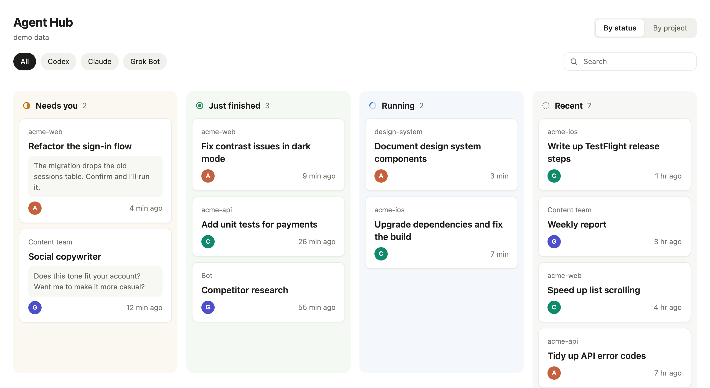
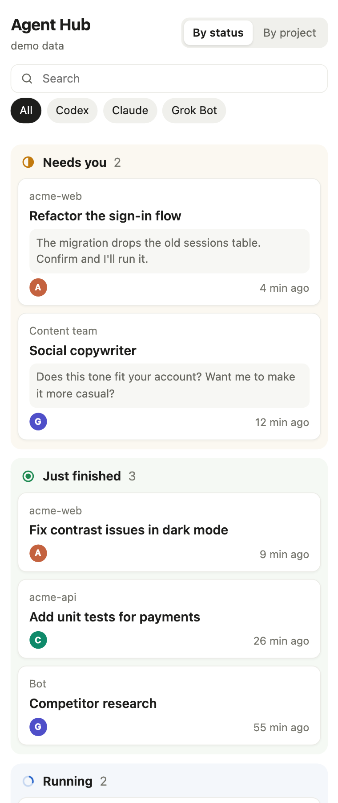

# Agent Hub

[中文说明](README.zh-CN.md)

One local dashboard for every AI agent conversation running in your **desktop apps** — Codex (ChatGPT app), Claude, and Grok Bot — with click-to-jump back into the exact conversation.

When you have a dozen agents working across three apps, it's hard to tell which one is waiting for you, which just finished, and which is still running. Agent Hub reads each app's local data, sorts every conversation onto a status board, and opens the right conversation in the right app when you click a card.





Narrow the window and it turns into a single stacked list, so it can sit beside your agent app.

*Screenshots use the built-in demo data.*

<br clear="right">


## Features

- **Status board** — four columns: *Needs you* → *Just finished* (not opened yet) → *Running* → *Recent*.
- **Project board** — Codex and Claude sessions from the same folder grouped together; Grok bots grouped by their team.
- **Click to jump** — opens the conversation in its own app via the app's URL scheme (`codex://`, `claude://`, `grokbot://`).
- **Fits a sidebar** — 4 columns when wide, 2×2 at half screen, a single stacked column when narrowed beside your agent app.
- **Keyboard** — arrows to move, `Enter` to open, `Space` to peek at the last message, `U` to mark as viewed, `/` to search.
- **Private and read-only** — everything stays on your Mac. It never modifies the apps' data and makes no network requests.
- **English and Chinese** — follows your system language; add `?lang=en` or `?lang=zh` to the URL to switch.
- **No dependencies** — one Python file (standard library only) and one HTML page. Light and dark mode.

## Requirements

- macOS
- Python 3.9+ (the one that ships with Xcode Command Line Tools works)
- One or more of:
  - **ChatGPT desktop app** with Codex (reads `~/.codex`)
  - **Claude desktop app**, Code tab sessions (reads `~/Library/Application Support/Claude/claude-code-sessions`)
  - **Grok Bot desktop app** (reads `~/Library/Application Support/Grok Bot`)

Apps you don't have are simply skipped.

## Quick start

```bash
git clone https://github.com/SiegoZhang/agent-hub.git
cd agent-hub
python3 agent_hub.py
```

Your browser opens `http://127.0.0.1:47321`. Keep the terminal open while you use it; `Ctrl+C` quits.

You can also double-click **`启动 Agent Hub.command`** in Finder. The first time, macOS may ask you to confirm opening it: right-click → Open.

Options:

- `AGENT_HUB_PORT=8000 python3 agent_hub.py` — use another port
- `python3 agent_hub.py --no-open` — don't open the browser automatically
- `python3 agent_hub.py --demo` — show made-up sample conversations instead of reading your apps (nothing is opened or saved); handy for a first look or for screenshots

## How statuses are worked out

| Status | Codex | Claude | Grok Bot |
|---|---|---|---|
| Running | last turn started and not finished | you sent a message and the turn hasn't ended | — |
| Needs you | not available in Codex's local data | session is waiting for input or confirmation | bot is awaiting your reply |
| Just finished | finished after you last opened it from Agent Hub | finished after you last focused it in Claude | unread messages, or activity after you last viewed it |

Agent Hub remembers which finished conversations you opened (or marked with `U`) in `agent_hub_state.json` next to the script — the only file it writes. On first launch only the last 6 hours count as "just finished", so your history doesn't flood the column.

## Limitations

- These apps don't publish an API for this. Agent Hub reads their local storage formats, which can change with any app update; when that happens a column may go empty until the reader is updated. Issues and PRs welcome.
- Claude chat conversations live in the cloud, so only Claude **Code** sessions are listed.
- Codex doesn't record "waiting for approval" locally, so Codex sessions never appear under *Needs you*.
- Codex has no reliable local read marker, so "viewed" only counts opens made through Agent Hub.

## Security

The server listens on `127.0.0.1` only. The page can only ask it to open a conversation by app and id; the server validates the id and builds the deep link itself, and rejects requests from other origins.

## Not affiliated

Agent Hub is an independent project and is not affiliated with or endorsed by OpenAI, Anthropic, or xAI. Product names are used only to describe compatibility.

## License

[MIT](LICENSE)
