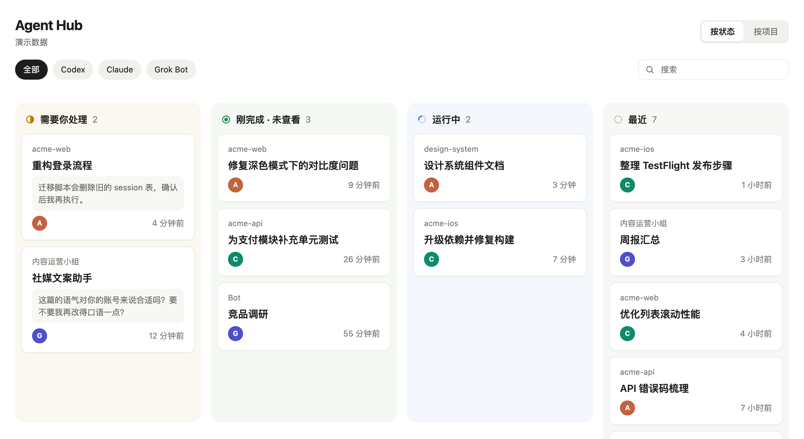
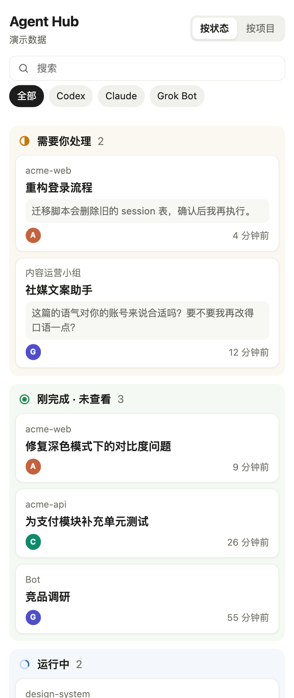

# Agent Hub

[English](README.md)

一个本地面板，统一查看你在各个**桌面应用**里运行的 AI agent 对话：Codex（ChatGPT 应用）、Claude 和 Grok Bot。点击卡片就能跳回对应应用里的那个对话。

同时开着十几个 agent、分散在三个应用里时，很难一眼看出哪个在等你回复、哪个刚做完、哪个还在跑。Agent Hub 读取各应用存在本地的数据，把所有对话按状态排进看板，点击卡片就在对应应用里打开那个对话。





把窗口拖窄，看板会变成一列竖排，可以放在 agent 应用旁边当侧边栏用。

*截图用的是内置的演示数据。*

<br clear="right">


## 功能

- **按状态看板**：四列，依次是「需要你处理 → 刚完成 · 未查看 → 运行中 → 最近」。
- **按项目看板**：同一个文件夹下的 Codex 和 Claude 会话放在一起，Grok Bot 按所属群组归类。
- **点击跳转**：用各应用自己的链接协议（`codex://`、`claude://`、`grokbot://`）打开对应对话。
- **适配侧边栏**：宽屏四列，半屏两列两行，缩窄放在 agent 应用旁边时变成一列竖排。
- **键盘操作**：方向键选择，回车打开，空格预览最后一条消息，`U` 标为已看，`/` 搜索。
- **本地只读**：数据不离开你的 Mac，不修改任何应用的数据，不发任何网络请求。
- **中英双语**：跟随系统语言自动切换；在网址后加 `?lang=zh` 或 `?lang=en` 可以手动指定。
- **零依赖**：一个 Python 文件（只用标准库）加一个 HTML 页面，支持浅色和深色模式。

## 运行环境

- macOS
- Python 3.9 及以上（Xcode 命令行工具自带的就可以）
- 至少装了下面其中一个应用：
  - **ChatGPT 桌面版**里的 Codex（读取 `~/.codex`）
  - **Claude 桌面版** Code 页面的会话（读取 `~/Library/Application Support/Claude/claude-code-sessions`）
  - **Grok Bot 桌面版**（读取 `~/Library/Application Support/Grok Bot`）

没装的应用会自动跳过。

## 快速开始

```bash
git clone https://github.com/SiegoZhang/agent-hub.git
cd agent-hub
python3 agent_hub.py
```

浏览器会自动打开 `http://127.0.0.1:47321`。使用期间保持终端窗口开着，按 `Ctrl+C` 退出。

也可以在访达里双击 **`启动 Agent Hub.command`**。第一次打开时 macOS 可能要求确认：右键选「打开」即可。

可选参数：

- `AGENT_HUB_PORT=8000 python3 agent_hub.py`：换一个端口
- `python3 agent_hub.py --no-open`：不自动打开浏览器
- `python3 agent_hub.py --demo`：显示虚构的示例对话，不读取你的应用（点击不会打开应用，也不会记录已读），适合先看看效果或截图

## 状态是怎么判断的

| 状态 | Codex | Claude | Grok Bot |
|---|---|---|---|
| 运行中 | 最近一轮已开始、还没结束 | 你发了消息，这一轮还没结束 | — |
| 需要你处理 | Codex 本地数据里没有这项 | 会话在等你输入或确认 | Bot 在等你回复 |
| 刚完成 · 未查看 | 在你上次从面板打开之后又完成了 | 在你上次在 Claude 里查看之后又完成了 | 有未读消息，或在你上次查看之后有新动态 |

你在面板里打开过（或按 `U` 标为已看）的对话，会记在脚本旁边的 `agent_hub_state.json` 里，这是面板唯一会写入的文件。第一次启动时，只把最近 6 小时内完成的对话算作未查看，避免历史对话一下子全涌进这一列。

## 已知限制

- 这些应用没有为此提供公开接口。Agent Hub 读的是它们的本地存储格式，应用更新后格式可能变化，到时某一列可能读不出数据，需要更新读取代码。欢迎提 Issue 和 PR。
- Claude 的普通聊天记录存在云端，所以只列出 Claude **Code** 页面的会话。
- Codex 本地没有记录「等你批准操作」，所以 Codex 的会话不会出现在「需要你处理」里。
- Codex 本地没有可靠的已读标记，所以只有通过面板打开过的才算「已看」。

## 安全

服务只监听 `127.0.0.1`。页面只能按「应用 + 会话 ID」请求打开对话，由服务端校验 ID 并自己拼出跳转链接，并拒绝来自其他网页的请求。

## 声明

Agent Hub 是独立项目，与 OpenAI、Anthropic、xAI 没有任何关联，也未获得它们的认可。文中提到的产品名称仅用于说明兼容性。

## 许可证

[MIT](LICENSE)
